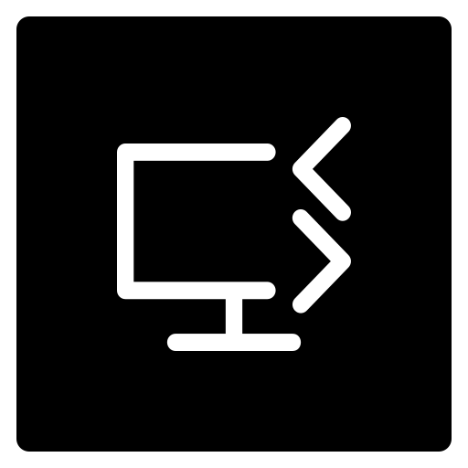

#  Web RDP


## Purpose

Web RDP is a user-friendly tool designed to enable remote control of a Windows computer directly through a web browser. This can be particularly useful for users who need to access their Windows machine from a different location or device.

## How to Use

#### **Getting Started:**

Clone the project to your computer:

```bash
git clone https://github.com/gokhangunduz/web-rdp
```

#### **Requirements:**

- Python 3.9 or newer must be installed.
- Install the project dependencies by running the following command in the terminal:

```bash
pip install -r requirements.txt
```

#### **Connection:**

Start the project by running the following command in the terminal (`start.bat` asks for administrator rights on Windows, `./start.sh` does the same job on macOS and Linux):

```bash
start.bat
```

The server prints the user name and a random password on startup. Set your own with `--password`.

#### **Control:**

Open the relevant url with the browser and log in.

```bash
<http - https>://<windows-host-ip>:7417
```

#### **Options:**

Options are passed to `start.bat` / `web-rdp.py`, or set through environment variables.

| Option       | Environment variable | Default   | Description                                  |
| ------------ | -------------------- | --------- | -------------------------------------------- |
| `--host`     | `WEB_RDP_HOST`       | `0.0.0.0` | Address to listen on, `127.0.0.1` for local  |
| `--port`     | `WEB_RDP_PORT`       | `7417`    | Port to listen on                            |
| `--username` | `WEB_RDP_USERNAME`   | `admin`   | Login user name                              |
| `--password` | `WEB_RDP_PASSWORD`   | random    | Login password, printed when generated       |
| `--cert`     | -                    | -         | TLS certificate, enables https and wss       |
| `--key`      | -                    | -         | TLS private key, required together with cert |

Example with encryption:

```bash
start.bat --password "my secret" --cert cert.pem --key key.pem
```

#### **Security:**

Anyone who can log in controls the whole computer. Always use a strong password, and use `--cert` and `--key` (or a reverse proxy with TLS) whenever the connection leaves a trusted network, because HTTP basic authentication is not encrypted on its own. Cross-site websocket requests are refused.

## Development

```bash
pip install -r requirements-dev.txt
ruff check . && ruff format --check .
pytest
```

The server is split into small modules: `web-rdp.py` (app and static files), `auth.py`, `config.py`, `ws.py` (websocket handlers), `frames.py` (screen encoding), `inputs.py` (input validation and replay) and `controller.py` (binary packet helpers).

## Contribution

web-rdp is an open source project and has a repository on GitHub. It is recommended that the project be forked and run on their local machine by developers willing to contribute. They can then create a pull request to push their changes back to the main repository.

The web-rdp project's GitHub page provides more information about the project's purpose, usage, and contributing guidelines. Developers who want to contribute to the project can follow the steps on this page.

Also, if you have any questions or suggestions about the project, you can reach the project managers using the contact information available on the GitHub page. Project managers are open to users' feedback and suggestions and will do their best to help improve the project.

## License

This project is licensed under the [MIT License](LICENSE).
